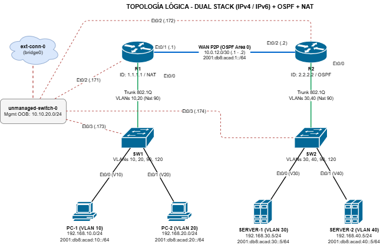

# 📡 Documentación de Infraestructura de Red 

---
### 📊 Topología de la red 

Esta red está diseñada con una arquitectura modular de acceso y enrutamiento Dual-Stack (IPv4/IPv6) con gestión Out-of-Band (OOB) dedicada.

---
### Descripción de la Topología

| **Elemento** | **Descripción** |
|--------------|-----------------|
| **R1**       | Router principal - Gateway de VLANs 10 y 20 + NAT/PAT + ACLs + DHCP/DHCPv6 |
| **R2**       | Router secundario - Gateway de VLANs 30 y 40 + DHCP/DHCPv6                |
| **SW1**      | Switch de acceso - VLANs 10 (PC-1) y 20 (PC-2)                            |
| **SW2**      | Switch de acceso - VLANs 30 (Server-1) y 40 (Server-2)                    |
| **PC-1**     | Cliente en VLAN 10 (Direccionamiento dinámico DHCPv4 / DHCPv6)            |
| **PC-2**     | Cliente en VLAN 20 (Direccionamiento dinámico DHCPv4 / DHCPv6)            |
| **Server-1** | Servidor en VLAN 30 (Direccionamiento estático IPv4 / IPv6)               |
| **Server-2** | Servidor en VLAN 40 (Direccionamiento estático IPv4 / IPv6)               |

---

## 🌐 Direccionamiento IP

### Tabla General de Dispositivos

| Dispositivo | Interfaz | Dirección IPv4 / IPv6 | Máscara / Prefijo | Gateway | VLAN | Descripción |
| :--- | :--- | :--- | :--- | :--- | :--- | :--- |
| **R1** | Ethernet0/2 | `10.10.20.171` | `255.255.255.0` | `10.10.20.254` | - | Management OOB (CML) |
| | Ethernet0/0.10 | `192.168.10.1` / `2001:db8:acad:10::1` | `/24` / `/64` | - | 10 | Gateway VLAN 10 |
| | Ethernet0/0.20 | `192.168.20.1` / `2001:db8:acad:20::1` | `/24` / `/64` | - | 20 | Gateway VLAN 20 |
| | Ethernet0/1 | `10.0.12.1` / `2001:db8:acad:1::1` | `/30` / `/64` | - | - | Enlace WAN P2P a R2 |
| | Loopback100 | `200.1.1.1` / `2001:db8:ffff::1` | `/30` / `/64` | - | - | Simulación ISP / Internet (`nat outside`) |
| **R2** | Ethernet0/2 | `10.10.20.172` | `255.255.255.0` | `10.10.20.254` | - | Management OOB (CML) |
| | Ethernet0/0.30 | `192.168.30.1` / `2001:db8:acad:30::1` | `/24` / `/64` | - | 30 | Gateway VLAN 30 |
| | Ethernet0/0.40 | `192.168.40.1` / `2001:db8:acad:40::1` | `/24` / `/64` | - | 40 | Gateway VLAN 40 |
| | Ethernet0/1 | `10.0.12.2` / `2001:db8:acad:1::2` | `/30` / `/64` | - | - | Enlace WAN P2P a R1 |
| **SW1** | Ethernet0/3 | `10.10.20.173` | `255.255.255.0` | `10.10.20.254` | - | Management OOB (CML) |
| **SW2** | Ethernet0/3 | `10.10.20.174` | `255.255.255.0` | `10.10.20.254` | - | Management OOB (CML) |
| **PC-1** | eth0 | DHCP / DHCPv6 | `/24` / `/64` | `192.168.10.1` / `fe80::10` | 10 | Host cliente (SW1 Et0/0) |
| **PC-2** | eth0 | DHCP / DHCPv6 | `/24` / `/64` | `192.168.20.1` / `fe80::20` | 20 | Host cliente (SW1 Et0/1) |
| **Server-1** | eth0 | `192.168.30.5` / `2001:db8:acad:30::5` | `/24` / `/64` | `192.168.30.1` / `2001:db8:acad:30::1` | 30 | Servidor HTTP (SW2 Et0/0) |
| **Server-2** | eth0 | `192.168.40.5` / `2001:db8:acad:40::5` | `/24` / `/64` | `192.168.40.1` / `2001:db8:acad:40::1` | 40 | Servidor HTTP (SW2 Et0/1) |

---

## 📊 VLANs y Subredes

| **VLAN ID** | **Nombre** | **Subred IPv4** | **Subred IPv6** | **Gateway IPv4** | **Gateway IPv6** | **Dispositivos** |
|-------------|------------|-----------------|-----------------|------------------|------------------|------------------|
| 10 | VLAN 10 | 192.168.10.0/24 | 2001:db8:acad:10::/64 | 192.168.10.1 | 2001:db8:acad:10::1 | PC-1, SW1 |
| 20 | VLAN 20 | 192.168.20.0/24 | 2001:db8:acad:20::/64 | 192.168.20.1 | 2001:db8:acad:20::1 | PC-2, SW1 |
| 30 | VLAN 30 | 192.168.30.0/24 | 2001:db8:acad:30::/64 | 192.168.30.1 | 2001:db8:acad:30::1 | Server-1, SW2 |
| 40 | VLAN 40 | 192.168.40.0/24 | 2001:db8:acad:40::/64 | 192.168.40.1 | 2001:db8:acad:40::1 | Server-2, SW2 |
| 90 | NATIVA | - | - | - | - | Native VLAN (Trunk) |
| 120 | BLACKHOLE | - | - | - | - | VLAN reservada (Blackhole) |

---

## ⚙️ Configuraciones en Común

### Aplicado a TODOS los dispositivos (Switches y Routers)

| **Parámetro** | **Valor** |
|---------------|-----------|
| **Usuario** | `cisco` (Privilegio 15) |
| **Password** | `cisco` |
| **Enable Secret** | `cisco` |
| **Dominio** | `local.com` |
| **SSH Version** | 2 |
| **Key RSA** | 2048 bits |
| **Transport Input** | SSH (`transport input ssh`) |
| **Logging Console** | Deshabilitado (`no logging console`) |
| **Cifrado de Contraseñas** | `service password-encryption` |

---

## 🔧 Configuraciones de Switches de Acceso

#### ✅ Configuraciones en SW1 y SW2

**Configuraciones Generales:**
- ✅ Hostname asignado según dispositivo (`SW1`, `SW2`)
- ✅ Enable secret configurado
- ✅ VLANs creadas (10, 20 en SW1; 30, 40 en SW2; 90 y 120 `blackhole` en ambos)
- ✅ IP CEF habilitado (en SW1)
- ✅ Usuario local con privilegios (`cisco`/`cisco`)
- ✅ SSH habilitado (versión 2) con clave RSA de 2048 bits y dominio `local.com`
- ✅ Service password-encryption activado
- ✅ `no logging console` configurado
- ✅ Líneas VTY con `login local` y transporte exclusivo SSH
- ✅ Línea Console con `exec-timeout 0 0` y `logging synchronous`

**Seguridad en Capa 2 (Puertos de Acceso y DHCP Snooping):**
- ✅ DHCP Snooping global habilitado en VLANs de usuario (`10,20` en SW1 / `30,40` en SW2)
- ✅ `no ip dhcp snooping information option` configurado
- ✅ `ip dhcp snooping limit rate 15` en puertos de acceso (`Et0/0`, `Et0/1`)
- ✅ `ip dhcp snooping trust` configurado en el puerto Trunk (`Et0/2`)
- ✅ Port-Security habilitado (`violation restrict` y `mac-address sticky`)
- ✅ `spanning-tree portfast` y `spanning-tree bpduguard enable` en puertos de acceso

**Configuraciones de Puertos:**
- ✅ Puertos de acceso asignados a su VLAN correspondiente (`Et0/0` y `Et0/1`)
- ✅ Puerto Trunk configurado en `Ethernet0/2` (`encapsulation dot1q`)
- ✅ Native VLAN 90 y filtrado de VLANs permitidas en el Trunk (`10,20,90` y `30,40,90`)
- ✅ Configuración guardada en NVRAM (`copy running-config startup-config`)

---

#### ✅ Configuraciones en Routers

**Configuraciones Generales:**
- ✅ Hostname asignado según dispositivo (`R1`, `R2`)
- ✅ Enable secret configurado
- ✅ `ipv6 unicast-routing` e `ip cef` habilitados
- ✅ Usuario local con privilegios (`cisco`/`cisco`)
- ✅ SSH habilitado (versión 2) con clave RSA de 2048 bits y dominio `local.com`
- ✅ Service password-encryption activado y `no logging console`
- ✅ Líneas VTY con `login local` y `transport input ssh`
- ✅ Línea Console con password `cisco`, `exec-timeout 0 0` y `logging synchronous`

**Configuraciones de Interfaces:**
- ✅ Subinterfaces configuradas (Router-on-a-Stick) en `Ethernet0/0` con encapsulación `dot1Q`
- ✅ Subinterfaz nativa `Ethernet0/0.90` (`encapsulation dot1Q 90 native`)
- ✅ Direccionamiento Dual-Stack (IPv4 + IPv6 Global Unicast + Link-Local personalizado `fe80::10`, `fe80::20`, `fe80::30`, `fe80::40`)
- ✅ Enlace punto a punto `Ethernet0/1` entre R1 y R2 (`10.0.12.0/30` y `2001:db8:acad:1::/64`)
- ✅ Interfaz `Loopback100` en R1 simulando salida a Internet (`200.1.1.1/30` y `2001:db8:ffff::1/64`)

**DHCP y DHCPv6 Stateful:**
- ✅ Pools DHCP IPv4 creados (`VLAN10_A`, `VLAN20_A` en R1; `VLAN30_A`, `VLAN40_A` en R2)
- ✅ Direcciones excluidas configuradas (`.1` a `.10` en cada subred)
- ✅ Default-router, DNS Server (`8.8.8.8`) y lease time (7 días) configurados
- ✅ Pools DHCPv6 Stateful configurados (`VLAN10_EMPRESA` a `VLAN40_EMPRESA`) con DNS `2606:4700:4700::1111`
- ✅ Flags ND configurados en subinterfaces: `no-autoconfig`, `managed-config-flag` (M=1) y `other-config-flag` (O=1)

**Enrutamiento (OSPFv2 y OSPFv3):**
- ✅ OSPFv2 y OSPFv3 (Proceso 10, Área 0) configurados con Router-ID `1.1.1.1` (R1) y `2.2.2.2` (R2)
- ✅ Enlace `Ethernet0/1` configurado en modo `point-to-point` para IPv4 e IPv6
- ✅ Subinterfaces LAN configuradas como `passive-interface`
- ✅ Rutas por defecto en R1 apuntando a `Loopback100` (`0.0.0.0/0` y `::/0`) propagadas mediante `default-information originate always`

**NAT / PAT y Port Forwarding (Solo R1):**
- ✅ Pool público `PUBLICOS` configurado (`200.1.1.5` - `200.1.1.10`, máscara `/30`)
- ✅ ACL extendida `NAT_LAN` permitiendo las 4 subredes internas (`192.168.10.0` a `40.0/24`)
- ✅ NAT Overload (PAT) activo (`ip nat inside source list NAT_LAN pool PUBLICOS overload`)
- ✅ NAT Estático (Port Forwarding) hacia servidores internos usando la IP pública `200.1.1.11`:
  - TCP Puerto `80` → `192.168.30.5:80` (Server-1)
  - TCP Puerto `8080` → `192.168.40.5:80` (Server-2)

**Seguridad y Filtrado (ACLs IPv4 e IPv6 en R1):**
- ✅ **VLAN 10 (`ACL_VLAN10_IN` / `ACL6_VLAN10_IN`):** Permite DHCP, tráfico hacia su gateway, acceso exclusivo hacia la **VLAN 40** (`192.168.40.0/24` y `2001:db8:acad:40::/64`), deniega el resto de subredes internas (`192.168.0.0/16` y `2001:db8:acad::/48`) y permite salida a Internet (`any`).
- ✅ **VLAN 20 (`ACL_VLAN20_IN` / `ACL6_VLAN20_IN`):** Permite DHCP, tráfico hacia su gateway, bloquea todo el tráfico hacia las redes internas (`192.168.0.0/16` y `2001:db8:acad::/48`) y permite únicamente salida a Internet (`any`).

**Guardado de Configuración:**
- ✅ Configuración guardada en NVRAM (`copy running-config startup-config`)

---

## 🐍 Scripts de Automatización (Python + Netmiko)

1. **Aprovisionamiento de Configuración (`read_file.py`):**
   - Lee archivos de configuración plana (`R1.txt`), filtra líneas en blanco y comentarios (`!`), y despliega los comandos vía SSH usando `send_config_set()`.
2. **Recolección de Inventario (`device_information.py`):**
   - Se conecta vía SSH a los 4 dispositivos (`10.10.20.171` – `10.10.20.174`).
   - Ejecuta `show version` y `show interface` aplicando plantillas **TextFSM** para estructurar los datos (versión de IOS, interfaces, descripciones, direcciones IP, direcciones MAC y estado físico/lógico).
   - Imprime tablas formateadas en consola mediante `tabulate` y exporta los reportes `reporte_inventario.txt` y `reporte_inventario.csv` en la carpeta `Reportes/`.
