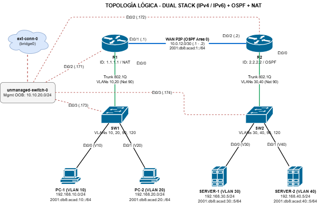

### 🏢 Dual-Stack Network & Automated Device Backups (Cisco CML Topology)

Este laboratorio implementa una infraestructura empresarial Dual-Stack (IPv4 e IPv6) simulada en Cisco Modeling Labs (CML). Los dispositivos cuentan con segmentación por VLANs, enrutamiento dinámico OSPFv2/OSPFv3, DHCP/DHCPv6 Stateful, NAT/PAT con Port Forwarding, seguridad en Capa 2/Capa 3 y un script de automatización desarrollado en Python y Netmiko (`automatizacion_dos.py`) para el respaldo automático de la configuración de toda la infraestructura organizado por fecha.

---

### 🎯 Objetivos del Laboratorio

- ✅ Segmentar la red en VLANs (10, 20, 30, 40 y Nativa 90) con Router-on-a-Stick.
- ✅ Implementar enrutamiento dinámico OSPFv2 y OSPFv3 (Área 0) para comunicación inter-VLAN y salida a Internet.
- ✅ Proveer servicios DHCPv4, DHCPv6 Stateful y NAT Overload (PAT) + NAT Estático (Port Forwarding).
- ✅ Asegurar los puertos de acceso con Port-Security, BPDU Guard y DHCP Snooping.
- ✅ Aplicar políticas de filtrado inter-VLAN mediante ACLs extendidas en IPv4 e IPv6.
- ✅ Automatizar copias de seguridad (`sh run`) organizadas por fecha UTC con Python y Netmiko.

---

### 📊 Topología de la Red

La topología separa el tráfico de producción Dual-Stack (IPv4/IPv6 entre switches, routers y hosts) de la red de administración dedicada Out-of-Band (OOB).



---

### 🌐 Arquitectura de Red (Plano de Datos y Plano de Gestión)

Esta topología utiliza un **Unmanaged Switch** exclusivamente para la **red de gestión (Out-of-Band Management)**. Las interfaces de administración de los equipos de red (`R1`, `R2`, `SW1` y `SW2`) están conectadas a este switch dentro del segmento `10.10.20.0/24` (`10.10.20.171` a `.174`), permitiendo el acceso remoto seguro exclusivamente vía **SSHv2** (credenciales `cisco`/`cisco`).

El tráfico de datos de usuarios y servidores viaja de forma totalmente independiente a través de las interfaces dedicadas (segmentos `192.168.x.x`, `2001:db8:acad::/48` y el enlace WAN `10.0.12.0/30`), garantizando que las tareas de administración y respaldo no interfieran con el rendimiento de la red de producción.

---

## 📂 Estructura del Repositorio

* `Código_Automatización_backups/`: Contiene el script `automatizacion_dos.py` en Python utilizando la librería Netmiko para extraer el `running-config` y guardarlo por fecha en el escritorio (`{hostname}__{ip}_config.txt`).
* `configs/`: Contiene los archivos de configuración individual listos para cargar vía consola o SSH en los equipos de CML2:
  * `Sw1.txt`, `Sw2.txt`
  * `R1.txt`, `R2.txt`
  * `Host.txt` (Scripts de configuración IPv4/IPv6 para clientes `udhcpc`/`udhcpc6` y servidores).
* `Notas/`: Explicación detallada del direccionamiento, políticas de seguridad y configuraciones aplicadas (`Notas.md`).
* `Topologia/`: Diagrama lógico de la topología en ejecución dentro del simulador (`topologia_logica.png`).

---

## 🛠️ Requisitos en los Dispositivos de Red

* **SSHv2 Habilitado**: Telnet está deshabilitado (`transport input ssh`) por razones de seguridad; Netmiko se conecta mediante SSH en el puerto 22.
* **Usuario Local**: Cuenta con credenciales válidas (`cisco`) y nivel de privilegio 15.
* **Contraseña de Enable**: Configurada (`enable secret cisco`) para ingresar al modo privilegiado y ejecutar `show running-config`.
* **Llaves Criptográficas**: Par de llaves RSA de 2048 bits generado en cada equipo.

---

## 🚀 Cómo Ejecutar el Script de Automatización

```bash
# 1. Instalar Netmiko
pip install netmiko

# 2. Ejecutar el script de backup
python automatizacion_dos.py

# 3. Verificar los backups generados (organizados por fecha YYYY-MM-DD)
ls ~/Desktop/Backup_Dispositivos_Laboratorio/
